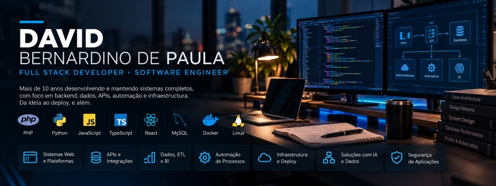
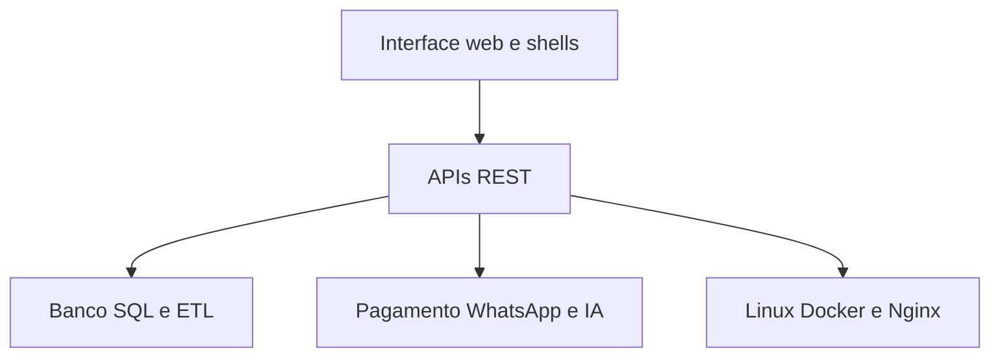

Desenvolvo o sistema e continuo nele depois que entra no ar: API, banco, integração, automação e servidor. Backend, dados e operação concentram a maior parte do trabalho. JavaScript, TypeScript e React cobrem a interface quando o produto pede. São mais de dez anos entre sistemas que já estavam em produção e plataformas que seguem recebendo função nova.

  <a href="#quem-sou">Quem sou</a> ·
  <a href="#o-que-eu-construo">O que eu construo</a> ·
  <a href="#stack">Stack</a> ·
  <a href="#experiencia">Experiência</a> ·
  <a href="#projetos">Projetos</a> ·
  <a href="#formacao">Formação</a> ·
  <a href="#contato">Contato</a>

---

## Quem sou

Trabalho com software que precisa permanecer no ar: usuário, pagamento, serviço externo e rotina que segue sem alguém na frente da tela. PHP e SQL/MySQL são a base, em nível sênior. Python, em nível pleno, fica no processamento, no ETL e na automação — inclusive na migração de processos do Pentaho/Kettle para APIs Python.

JavaScript, TypeScript e React cobrem a interface. Linux, Nginx e Docker cobrem o servidor. A pós-graduação em cybersecurity, cyber crimes e computação forense entra na segurança de aplicação e na análise técnica.

 

## O que eu construo

Sistemas em que cadastro, regra de negócio, dado e serviço externo precisam funcionar juntos.

- Plataformas com usuários, créditos e pagamento online
- SaaS, white label e aplicação multi-tenant
- APIs REST e integração entre sistemas
- ETL, BI e processamento de dados
- Player web de streaming (HLS.js e Video.js) no ecossistema GDPLAY
- Automação de processo, WhatsApp e testes com Selenium
- Shell desktop com PyWebView e shell mobile com Flutter, nas partes do GDPLAY que usam esses formatos

Ferramenta interna entra na mesma entrega: algo que a operação usa no dia a dia.

## Stack principal

PHP e SQL/MySQL em nível sênior. Python em nível pleno. Cada sistema usa um recorte desta tabela.

| Área | Com o que trabalho |
| --- | --- |
| Backend | PHP, Laravel, Python, C#, APIs REST |
| Dados | SQL, MySQL, SQL Server, Oracle, MongoDB, Redis |
| Frontend | JavaScript, TypeScript, React, Vite, Bootstrap, Tailwind CSS |
| Interface | Chart.js, DataTables, Leaflet, Mapbox |
| Infraestrutura | Docker, Docker Compose, Kubernetes, Minikube, Helm, Linux, Nginx, Nginx Proxy Manager |
| Ambientes | VPS, Oracle Cloud, Hostinger, Windows, Linux, XAMPP |
| Automação | Python, Selenium, WhatsApp, integração entre sistemas |
| Segurança | segurança de aplicações, cybersecurity, computação forense, perícia digital |
| Integrações | OpenAI, Gemini, Twilio, PHPMailer, Postfix, APIs de pagamento |

## Experiência técnica

### Sistemas e integração

Parto do que o produto precisa sustentar: usuário, permissão, conteúdo, crédito, pagamento, rotina. A API REST fica entre a interface, as automações e os serviços externos. Trabalho com sistema que já estava no ar e com a ligação entre sistemas que não nasceram para se falar. O caso concreto de troca de base é a migração de processos Pentaho para APIs Python.

### Dados

MySQL e SQL são a base em que mais trabalhei. Também entram SQL Server, Oracle, MongoDB e Redis, conforme o sistema. Modelagem e revisão de consulta fazem parte do trabalho quando a tela ou o lote passam a sentir o volume. Pipelines de extração e transformação, BI e o lado aplicado da formação em Data Science deixam o dado pronto para outro sistema consumir.

### Produção

Deploy e administração de servidor Linux, com Nginx e Docker Compose. Kubernetes, Minikube e Helm entram quando o ambiente pede orquestração. Os ambientes em que isso aparece são VPS, Oracle Cloud e Hostinger. E-mail de aplicação com Postfix e PHPMailer.

### Automação e IA

Selenium e Python para teste e para processo repetitivo. WhatsApp e Twilio quando a rotina sai da aplicação e vai para mensagem. OpenAI e Gemini entram como API dentro do produto: no AWM Simulados, o Professor AI analisa respostas de simulado; em código público, [text-and-file-to-voice](https://github.com/dvdbp206-hue/text-and-file-to-voice) gera áudio a partir de texto ou de arquivo.

## Projetos em destaque

### AWM Simulados

Plataforma de simulados para habilitação náutica. Desenvolvo e mantenho o sistema, do backend ao frontend.

- Simulados online e banco de questões
- Usuários e créditos
- Pagamentos online
- Automação via WhatsApp
- Integração com IA: Professor AI para análise das respostas

Site: [awmarmsimulados.com](https://awmarmsimulados.com/)

O código deste produto não está público.

### GD Simulados / GDPLAY

Ecossistema de simulados, streaming e sistemas web. Cada parte usa a stack do seu formato.

No conjunto aparecem PHP, React, TypeScript, Vite, Python, Flutter, PyWebView, Docker e APIs. O player web usa HLS, Video.js e HLS.js. Há aplicação multi-tenant, web player, shell desktop e shell mobile.

Site: [web.gdtv-iptv.com](https://web.gdtv-iptv.com/)  
Instaladores do shell desktop: [gdplay-install](https://github.com/dvdbp206-hue/gdplay-install)

O código das aplicações permanece privado. O repositório público contém os instaladores do shell desktop.

### Text and File to Voice

Ferramenta em Python. Converte texto livre ou arquivo PDF, DOCX e TXT em áudio, via OpenAI ou Gemini TTS, com interface gráfica e CLI.

Repositório: [text-and-file-to-voice](https://github.com/dvdbp206-hue/text-and-file-to-voice)

<!--
PLACEHOLDER / MODELO — copie para incluir o próximo projeto real. Apague este comentário quando não for mais útil.

### Nome do projeto
Uma frase: o que o sistema faz e qual parte você desenvolve.

- Fato concreto
- Fato concreto

Site:
Código: público ou privado
Repositório:
-->

## Áreas de atuação

Mapa de como as partes se encontram nos sistemas que eu entrego.

Esse recorte cobre sistema web, API, dado, automação e deploy. No GDPLAY entram também streaming e multi-tenant.

## Formação

- Análise e Desenvolvimento de Sistemas — UNINOVE — 2016–2018
- Pós-graduação em BI & Data Science — Faculdade Anhanguera — 2019–2020
- Pós-graduação em Desenvolvimento Web Full Stack — Faculdade Anhanguera — 2022–2023
- MBA em Cybersecurity & Cyber Crimes — Faculdade Anhanguera — 2022–2023
- Pós-graduação em Computação Forense e Perícia Digital
- Formação profissional em elétrica — SENAI

## Em produção

Sigo na manutenção e na evolução do AWM Simulados e do ecossistema GDPLAY.

<!-- PLACEHOLDER: estudo atual, disponibilidade ou vínculo profissional. Preencher só com fato. -->

## Publicação

Landing do ebook Confiança Divina, de minha autoria, em HTML, CSS e JavaScript: [repositório](https://github.com/dvdbp206-hue/confianca-divina-landing) · [demo](https://confianca-divina.david-portifolio.com.br/)

## Contato

- Portfólio: [david-portifolio.com.br](https://david-portifolio.com.br/)
- LinkedIn: [David Bernardino de Paula](https://www.linkedin.com/in/david-de-paula-3b5964b1/)
- GitHub: [dvdbp206-hue](https://github.com/dvdbp206-hue)

<!-- PLACEHOLDER: e-mail de contato -->
